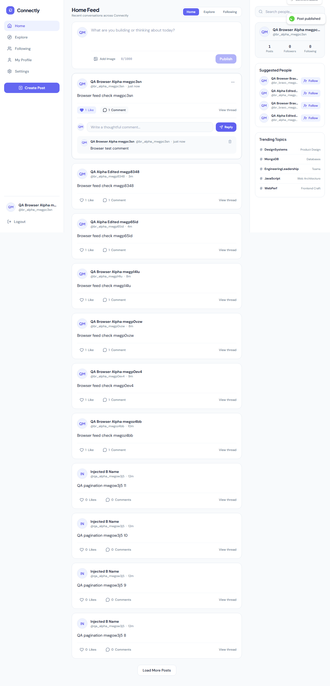
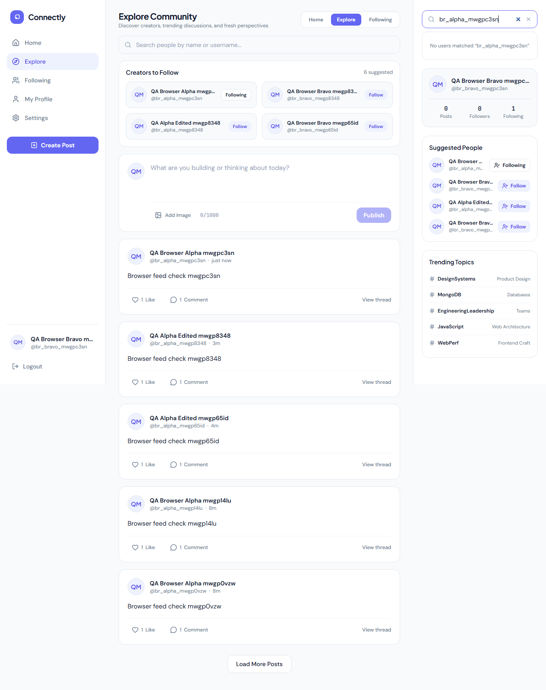
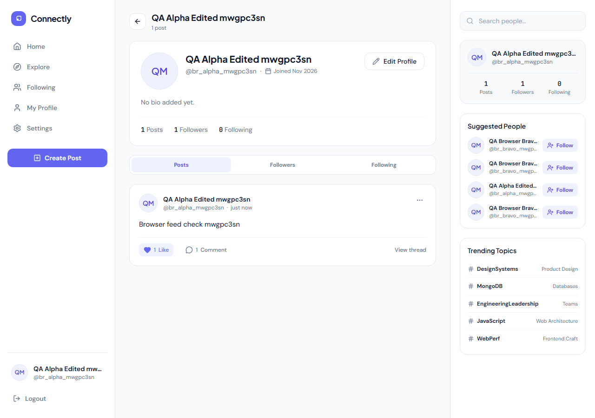
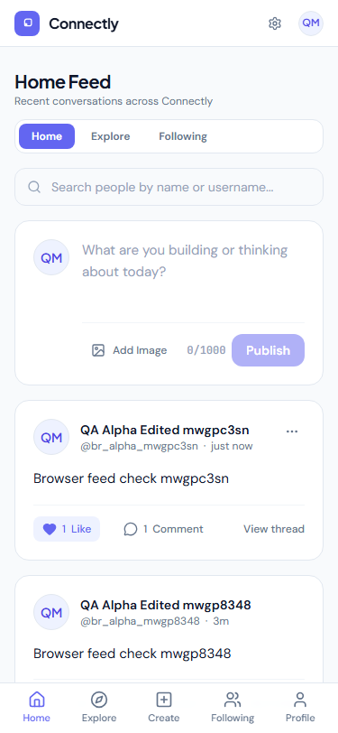

# Connectly — Social Media Platform

**Connectly** is a full-stack social media platform for sharing posts, connecting with people, and chatting with friends. This repository contains the Next.js frontend; the Express.js API is maintained in the separate `Connectly_Backend` repository. Both use MongoDB, HttpOnly JWT cookie authentication, and optional ImgBB image hosting.

---

## Features

- **Authentication & Sessions**: Registration, login, logout, persistent HttpOnly JWT cookie sessions, `bcryptjs` password hashing, and protected routes for feeds, profiles, friends, and messages.
- **User Profiles & Follow Graph**: Public profiles (`/profile/[id]`) displaying bio, avatar, join date, post/follower/following counts, interactive followers/following lists, and profile editing (own profile only).
- **Posts CRUD & Pagination**: Create text/image posts, edit and delete own posts with confirmation dialog, view single-post thread pages (`/post/[id]`), and paginate feeds with **Load More**.
- **ImgBB Image Uploads**: Multipart upload parsing (`busboy`) on the Express backend forwarded to the ImgBB API (`IMGBB_API_KEY` stored strictly server-side); only the returned image URL is saved to MongoDB.
- **Social Interactions**: Atomic like/unlike updates with a liker list, threaded replies to comments, inline collapsible discussions, and follow/unfollow relationships enforced by compound unique indexes.
- **Friend Chat & Notifications**: Send and accept friend requests, chat in real time with accepted friends, see unread counts across navigation and conversations, and receive in-app notifications. Optional desktop alerts work while Connectly is open in a browser.
- **Discovery & Search**: Chronological Home feed (`/home`), Explore Community (`/explore`) with topic filtering and suggested creators, personalized Following feed (`/following`), and live user search.
- **Responsive Layout**: Three-column desktop dashboard (`LeftSidebar` + Feed + `RightSidebar`), two-column tablet layout (right discovery sidebar hidden, inline search shown), and single-column mobile layout with sticky header and fixed bottom navigation.

---

## Tech Stack

- **Frontend (`frontend/`)**: Next.js 15 (App Router, JavaScript), React 19, Tailwind CSS v4, HeroUI (`@heroui/react`), Zustand (`authStore`, `postStore`, `userStore`), Lucide React, React Hot Toast
- **Backend (separate `Connectly_Backend` repository)**: Node.js, Express.js, MongoDB Native Driver (`mongodb`), JSON Web Tokens (`jsonwebtoken`), `bcryptjs`, `busboy`, `cors`, `cookie-parser`, `ws`, ImgBB API

---

## Folder Structure

```text
Connectly/
├── frontend/
│   ├── src/
│   │   ├── app/
│   │   │   ├── (auth)/
│   │   │   │   ├── login/page.jsx
│   │   │   │   └── register/page.jsx
│   │   │   ├── (main)/
│   │   │   │   ├── layout.jsx
│   │   │   │   ├── home/page.jsx
│   │   │   │   ├── explore/page.jsx
│   │   │   │   ├── following/page.jsx
│   │   │   │   ├── friends/page.jsx
│   │   │   │   ├── messages/page.jsx
│   │   │   │   ├── messages/[conversationId]/page.jsx
│   │   │   │   ├── profile/page.jsx
│   │   │   │   ├── profile/[id]/page.jsx
│   │   │   │   ├── settings/page.jsx
│   │   │   │   └── post/[id]/page.jsx
│   │   │   ├── globals.css
│   │   │   ├── layout.jsx
│   │   │   ├── not-found.jsx
│   │   │   ├── page.jsx
│   │   │   └── providers.jsx
│   │   ├── components/
│   │   ├── services/
│   │   │   └── api.js
│   │   ├── store/
│   │   │   ├── authStore.js
│   │   │   ├── postStore.js
│   │   │   └── userStore.js
│   │   └── utils/
│   ├── .env.example
│   ├── next.config.mjs
│   ├── package.json
│   └── postcss.config.mjs
├── docs/
│   └── screenshots/
├── .gitignore
├── package.json                # Convenience scripts for the frontend
└── README.md
```

The backend is not part of this repository. Clone it separately from `https://github.com/mohiuddinshanto/Connectly_Backend` and follow its README.

## Task 2 requirement checklist

| Requirement | Connectly implementation |
| --- | --- |
| User profiles | Public and editable profiles, avatars, bios, and follower/following counts |
| Posts and comments | Persistent posts, threaded comments/replies, and paginated feeds |
| Like/follow system | Like/unlike with liker lists, plus persistent follow/unfollow relationships |
| Database | MongoDB collections for users, posts, comments, follows, friendships, and messages |
| Frontend | JavaScript with Next.js/React and Tailwind CSS, rendering HTML pages |
| Backend | Express.js REST API with authenticated routes |

---

## Setup Steps

1. **Clone both repositories**:
   ```bash
   git clone https://github.com/mohiuddinshanto/Connectly.git
   git clone https://github.com/mohiuddinshanto/Connectly_Backend.git
   ```

2. **Configure the backend** (in the backend repository):
   ```bash
   cd Connectly_Backend
   cp .env.example .env
   ```
   Set `MONGODB_URI`, `JWT_SECRET`, and the frontend origin in `CLIENT_URL`. Set `IMGBB_API_KEY` only when image uploads are needed.

3. **Configure and install the frontend** (in the frontend repository):
   ```bash
   cd ../Connectly
   npm --prefix frontend install
   cp frontend/.env.example frontend/.env.local
   ```
   Set `API_URL` in `frontend/.env.local` to the backend URL ending in `/api`; use `http://localhost:5000/api` for local development.

4. **Run both services in separate terminals**:
   ```bash
   # Terminal 1, in Connectly_Backend
   npm run dev

   # Terminal 2, in Connectly
   npm run dev
   ```
   Frontend: `http://localhost:3000`. Backend API: `http://localhost:5000`. The frontend proxies browser `/api/*` requests through its server-only `API_URL`.

5. **Test and build**:
   ```bash
   # In Connectly_Backend
   npm test

   # In Connectly
   npm run build
   ```

---

## Environment Variables

### Backend `.env.example` (separate repository)

| Variable | Description | Example / Default |
| --- | --- | --- |
| `PORT` | Express API listening port | `5000` |
| `MONGODB_URI` | MongoDB connection string (required) | `mongodb+srv://...` |
| `MONGODB_DB_NAME` | Target MongoDB database name | `connectly` |
| `JWT_SECRET` | Secret key for signing JWT cookies (required) | `your-random-secret` |
| `CLIENT_URL` | Allowed CORS origin(s) | `http://localhost:3000` |
| `IMGBB_API_KEY` | Server-side ImgBB API key (required for image uploads) | `your-imgbb-key` |
| `CROSS_SITE_COOKIES` | Set to `true` only when frontend and API are on different sites; enables `SameSite=None; Secure` | `false` |

### `frontend/.env.example`

| Variable | Description | Default |
| --- | --- | --- |
| `API_URL` | Server-side backend API base URL used by the Next.js proxy | `http://localhost:5000/api` |

---

## MongoDB Collections & Indexes

- `users`: `{ email: 1 }` (unique), `{ username: 1 }` (unique)
- `posts`: `{ authorId: 1, createdAt: -1 }`, `{ createdAt: -1 }`
- `comments`: `{ postId: 1 }`, `{ parentCommentId: 1 }`
- `follows`: `{ followerId: 1, followingId: 1 }` (unique), `{ followingId: 1, createdAt: -1 }`
- `friendships`: unique friend-pair key and requester/recipient status indexes
- `messages`: conversation history, idempotent client message IDs, and recipient/read-state index

---

## API Endpoint Table

### Health & Authentication
| Method | Endpoint | Auth | Description |
| --- | --- | --- | --- |
| `GET` | `/api/health` | Public | API health & MongoDB connection mode |
| `POST` | `/api/auth/register` | Public | Register account and set HttpOnly JWT cookie |
| `POST` | `/api/auth/login` | Public | Authenticate user and set HttpOnly JWT cookie |
| `POST` | `/api/auth/logout` | Public | Clear authentication cookie |
| `GET` | `/api/auth/me` | Required | Get currently authenticated user |

### Users & Follow System
| Method | Endpoint | Auth | Description |
| --- | --- | --- | --- |
| `GET` | `/api/users` | Optional | List suggested users |
| `GET` | `/api/users/search?q=` | Optional | Search users by name or username |
| `PUT` | `/api/users/profile` | Required | Update own profile (`name`, `bio`, `profilePicture`) |
| `POST` | `/api/users/upload-avatar` | Required | Upload avatar via Express -> ImgBB |
| `GET` | `/api/users/:id` | Optional | Fetch public profile and counts |
| `GET` | `/api/users/:id/posts` | Optional | Paginated posts authored by user |
| `GET` | `/api/users/:id/followers` | Optional | Paginated followers (`limit`, `skip`; default 50, max 100) |
| `GET` | `/api/users/:id/following` | Optional | Paginated following (`limit`, `skip`; default 50, max 100) |
| `POST` | `/api/users/:id/follow` | Required | Follow a user |
| `DELETE` | `/api/users/:id/follow` | Required | Unfollow a user |

### Friends & Chats
| Method | Endpoint | Auth | Description |
| --- | --- | --- | --- |
| `GET` | `/api/friends` | Required | List accepted friends and each conversation's unread count |
| `GET` | `/api/friends/requests` | Required | List incoming and outgoing friend requests |
| `GET` | `/api/friends/status/:userId` | Required | Get the current relationship state |
| `POST` | `/api/friends/requests/:userId` | Required | Send a friend request |
| `POST` | `/api/friends/requests/:requestId/accept` | Required | Accept a friend request |
| `DELETE` | `/api/friends/requests/:requestId` | Required | Decline or cancel a pending request |
| `GET` | `/api/chats/unread-count` | Required | Get total and per-conversation unread message counts |
| `POST` | `/api/chats/:conversationId/read` | Required | Mark incoming messages in a conversation as read |
| `GET` | `/api/chats/:conversationId` | Required | Get conversation details |
| `GET` | `/api/chats/:conversationId/messages` | Required | Get paginated chat history |
| `POST` | `/api/chats/socket-ticket` | Required | Create a short-lived WebSocket ticket |
| `WS` | `/api/ws` | Ticket | Deliver chat messages in real time |

### Posts, Likes & Comments
| Method | Endpoint | Auth | Description |
| --- | --- | --- | --- |
| `GET` | `/api/posts` | Optional | Paginated public/explore feed (`limit`, `skip`, `q`) |
| `GET` | `/api/posts/following` | Required | Paginated feed from followed accounts |
| `POST` | `/api/posts` | Required | Create a new post |
| `POST` | `/api/posts/upload-image` | Required | Upload post image via Express -> ImgBB |
| `GET` | `/api/posts/:id` | Optional | Fetch single post detail |
| `PUT` | `/api/posts/:id` | Required (Owner) | Update own post |
| `DELETE` | `/api/posts/:id` | Required (Owner) | Delete own post and its comments |
| `POST` | `/api/posts/:id/like` | Required | Atomically like a post |
| `DELETE` | `/api/posts/:id/like` | Required | Atomically unlike a post |
| `GET` | `/api/posts/:id/likes` | Optional | Paginated list of users who liked a post (`limit`, `skip`) |
| `GET` | `/api/posts/:id/comments` | Optional | Paginated comments (`limit`, `skip`; default 50, max 100) |
| `POST` | `/api/posts/:id/comments` | Required | Add a comment or a reply to a top-level comment (`parentCommentId`) |
| `DELETE` | `/api/comments/:id` | Required (Owner) | Delete own comment |

---

## Troubleshooting

- **Missing Environment Variables (`JWT_SECRET` or `MONGODB_URI`)**:
  Ensure `.env` exists in the backend repository (copied from its `.env.example`) and the required variables are populated. `IMGBB_API_KEY` is only required for image uploads.
- **MongoDB Connection Failed (`ECONNREFUSED` or `ServerSelectionError`)**:
  Verify your local `mongod` service is running or your MongoDB Atlas URI is valid, your IP is allowlisted in Atlas Network Access, and `MONGODB_URI` is reachable from the backend host.
- **CORS or Cookie Session Not Persisting**:
  - Set `API_URL` in `frontend/.env.local` to the backend URL ending in `/api`; browser requests go to the same-origin `/api` path and are proxied by Next.js.
  - Ensure `CLIENT_URL` in the backend `.env` matches the exact frontend origin (e.g. `http://localhost:3000`).
  - Cookies default to `SameSite=Lax`; set `CROSS_SITE_COOKIES=true` only when frontend and API are cross-site. That setting requires HTTPS and uses `SameSite=None; Secure`.
  - State-changing requests with an `Origin` header must match one of the comma-separated `CLIENT_URL` origins. Requests without an Origin header are allowed for command-line clients.

### Windows PowerShell commands

After configuring the backend and frontend environment files, start each repository in a separate terminal:

```powershell
# In Connectly_Backend
npm run dev

# In Connectly
npm run dev
```

For production, build the frontend in `Connectly` and start the backend using the instructions in the backend README:

```powershell
npm run build
```

## Screenshots

| Home feed (desktop) | Explore search (desktop) |
| --- | --- |
|  |  |

| Profile (desktop) | Home feed (mobile) |
| --- | --- |
|  |  |
