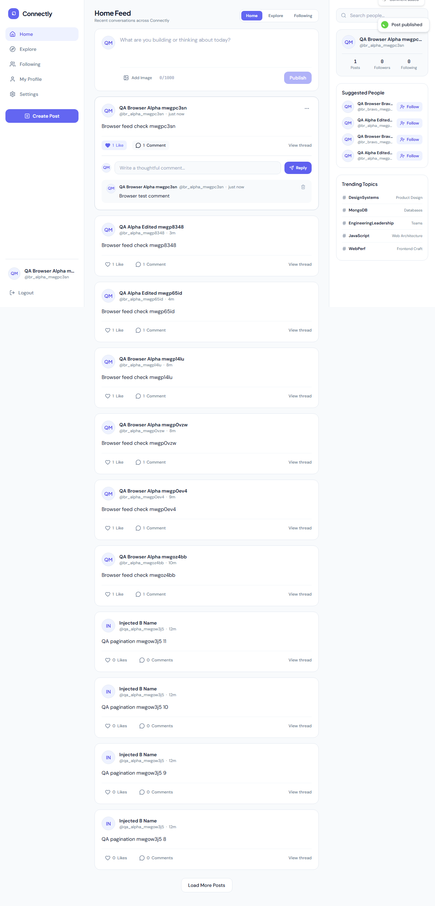
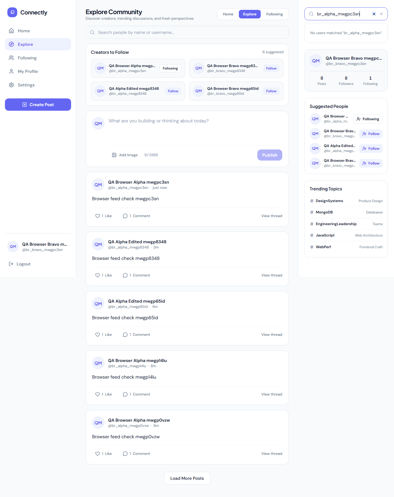
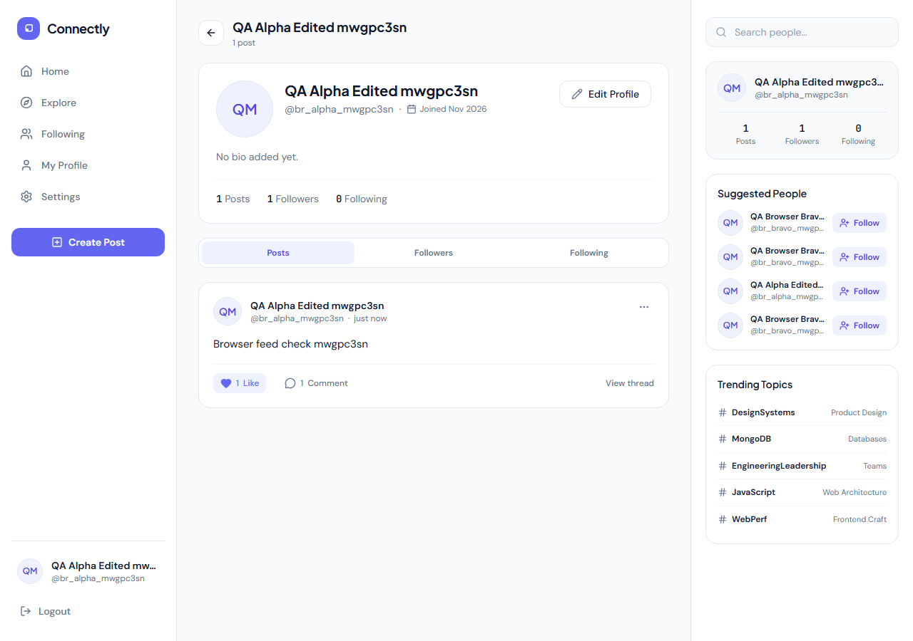
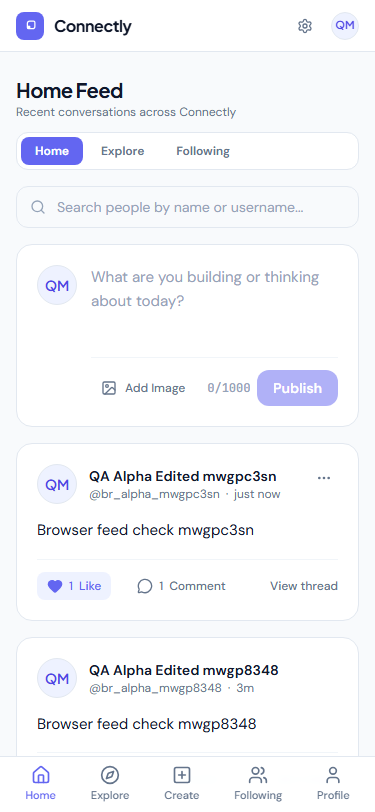

# Connectly — Frontend

The Next.js web app for Connectly, a social platform for sharing posts, discovering people, and building a community. This repository contains the frontend only; the Express API is maintained and deployed separately.

## Screenshots

| Home feed | Explore and search |
| --- | --- |
|  |  |

| Profile | Mobile feed |
| --- | --- |
|  |  |

> Screenshots live in [`docs/screenshots`](../docs/screenshots/). If this folder is not part of this repository after the frontend is split out, copy it into the frontend repository and update these image paths.

## Features

- Responsive home, explore, following, profile, and post pages
- Account registration and login with persistent cookie sessions
- Create, edit, and delete posts, including image uploads
- Like posts, comment, and follow other users
- Search users and discover creators by topic
- Next.js App Router with React, Tailwind CSS, HeroUI, and Zustand

## Requirements

- Node.js 20 or later
- A running Connectly backend (see the backend repository)

## Run locally

```bash
npm install
```

Copy the example environment file and configure the API URL:

```bash
cp .env.example .env.local
```

On Windows PowerShell, use `Copy-Item .env.example .env.local` instead. The default points to a local backend at `http://localhost:5000/api`.

Start the development server:

```bash
npm run dev
```

Open [http://localhost:3000](http://localhost:3000).

## Environment variables

| Variable | Required | Description |
| --- | --- | --- |
| `NEXT_PUBLIC_API_URL` | Yes | Backend API base URL, including `/api`. Local example: `http://localhost:5000/api`. Production example: `https://api.example.com/api`. This value is exposed to the browser; never put secrets here. |

## Build and run for production

```bash
npm run build
npm start
```

Set `NEXT_PUBLIC_API_URL` in the frontend hosting provider before building. Deploy this repository as a Next.js application and use its root directory as the project root.

## Connect to the backend

The frontend sends API requests directly to `NEXT_PUBLIC_API_URL` and uses cookie-based authentication. Configure the backend's `CLIENT_URL` with the exact frontend origin. For separately hosted frontend and backend domains, the backend must allow credentialed CORS and cross-site secure cookies; serve both over HTTPS. See the backend README for its environment and deployment setup.

## Scripts

| Command | Description |
| --- | --- |
| `npm run dev` | Start the Next.js development server on port 3000 |
| `npm run build` | Create a production build |
| `npm start` | Serve the production build on port 3000 |

## Tech stack

Next.js 15 · React 19 · Tailwind CSS 4 · HeroUI · Zustand · Lucide
